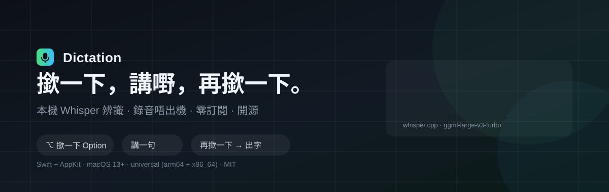
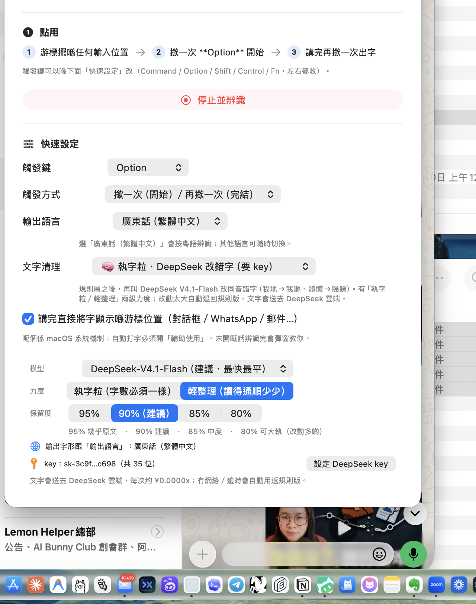

# Dictation — 自己造嘅 macOS 聽寫

> 撳一下 **Option**，講嘢，再撳一下 —— 文字直接打落你正在用嘅 App。
> 完全本地跑 Whisper，**零訂閱、零錄音上傳**。



---

## 為咩要自己造

Spokenly 之類嘅工具一年 US$96。用落唔差，但：

- 每年畀錢，而且改版改走你慣用嘅設定
- 錄音送去邊、用邊個 model、文字會唔會再送去第三方 —— 你唔知
- 想改個觸發鍵、改個清理規則，改唔到

呢個 app 全部自己話事：**whisper.cpp 本地辨識 + 自己寫嘅 Swift UI**。
錄音永遠唔出機（唯一例外係你自願開嘅 DeepSeek 改錯字，可以完全關掉）。

## 有咩唔同

| | 呢個 app | Spokenly Pro | macOS 內建聽寫 |
|---|---|---|---|
| 價錢 | **$0** | US$96/年 | $0 |
| 粵語 | ✅ | ✅ | ✅ |
| 錄音去邊 | **留喺你部機** | 雲端 | 雲端 |
| 觸發鍵 | Option／Command／Shift／Control／Fn | 有限 | 固定 |
| 錄音時靜音其他聲音 | ✅ 自動（錄完即刻還原） | ✅ | ❌ |
| 文字清理 | 5 種引擎，可以完全唔經 AI | 雲端改寫 | 改寫 |
| 字形 | 揀繁體就出繁體 | 跟系統 | 跟系統 |
| 改得 | **原始碼喺度** | ❌ | ❌ |

## 快速開始

```bash
git clone https://github.com/Chilli9527/dictation.git
cd dictation
bash install.sh
```

裝完開三個權限（**三個都要**）：

| 權限 | 位置 |
|---|---|
| 麥克風 | 系統設定 → 隱私權與安全性 → 麥克風 |
| **輸入監視** | 系統設定 → 隱私權與安全性 → **輸入監視** |
| 輔助使用 | 系統設定 → 隱私權與安全性 → 輔助使用 |

> ⚠️ macOS 15 起「輸入監視」同「輔助使用」係兩個獨立權限。
> 只開輔助使用 → 撳 Option **完全冇反應**，而且系統唔會提示你。

體檢：

```bash
bash check-deps.sh
```

## 點用

1. 游標擺喺任何輸入位置
2. 撳一下 **Option** → 聽到「嘟‑嗶」向上，**其他聲音（片／歌）即刻靜音**
3. 講嘢
4. 再撳一下 → 「嗶‑嘟」向下，聲音還原 → 文字自動貼上

> 🔇 **錄音時自動靜音其他聲音**（預設開，可以喺主視窗或選單列關掉）
> 睇住片都可以直接撳 Option 講嘢，唔會漏入咪、亦唔會嘈住你。
> 中途插耳機／轉 AirPods 會跟住靜音；錄完即刻還原；就算 app 意外死咗，
> 下次開返都會自動幫你解返靜音（有 crash 保險檔）。

想改觸發鍵：主視窗 → 快速設定 → 觸發鍵。



## 文字清理（五選一）

| 引擎 | 費用 | 行為 |
|---|---|---|
| **✨ 執字粒（預設）** | $0 | 純規則：口吃、填充詞、空格、標點。**唔經 AI，一個字都唔會加** |
| 🧠 執字粒 · DeepSeek | ~¥0.0001/句 | 規則層 + 雲端改同音錯字（我地→我哋）。可揀 V4.1-Flash／V4-Pro |
| 🚫 唔整理 | $0 | Whisper 出咩貼咩 |
| 🍎 Apple 內建 AI | $0 | 離線，但會改寫你嘅講法 |
| 🤖 GPT-4o mini | 要 OpenAI key | 會改寫 |

**字形一定跟「輸出語言」**：揀「廣東話（繁體中文）」→ 出繁體（Whisper 偶然吐簡體都會轉返）；
揀普通話 → 出簡體。中英夾雜（產品名、英文詞、數字）原樣保留。

## 技術

| | |
|---|---|
| 語言 | Swift 5（AppKit + SwiftUI，單檔約 3300 行） |
| 辨識 | [whisper.cpp](https://github.com/ggerganov/whisper.cpp) + `ggml-large-v3-turbo-q5_0`（547MB，16kHz mono） |
| 觸發 | `CGEventTap` 收修飾鍵 + 自動健康檢查／重建 |
| 貼上 | `NSPasteboard` + `CGEvent` 模擬 Cmd+V |
| 音效 | `AVAudioEngine` 即場合成正弦波 |
| 靜音 | CoreAudio HAL `kAudioDevicePropertyMute`（唔會改動你嘅音量數字）＋ crash 保險檔 |
| 字形 | `CFStringTransform`（ICU，離線） |
| 簽名 | 自簽 `Dictation Dev`（rebuild 唔會 reset 權限） |
| 平台 | macOS 13+，universal（arm64 + x86_64） |

## 踩過嘅坑

`references/troubleshooting.md` 有 14 條實戰記錄，包括：

- macOS 15 拆開「輸入監視」之後 CGEventTap **靜默死亡**
- 另一隻 app（Spokenly 背景 helper）喺 HID 層食咗修飾鍵
- 揀繁體卻出簡體嘅**兩個**獨立成因
- Apple FoundationModels 做唔到「只執字」（四種提示實測）
- 手寫 AppKit 冇建 `NSApp.mainMenu` → Cmd+C／Cmd+V 靜靜失效
- `-O` 之下 argv 嘅 String 放入 array 會 SIGSEGV

## 檔案結構

```
├── SKILL.md                  # agent 用（WorkBuddy / Claude Skill 格式）
├── README.md
├── install.sh                # 一鍵安裝
├── check-deps.sh             # 體檢（唯讀）
├── build.sh                  # 編譯 + 簽名 + 安裝
├── Sources/main.swift
├── Resources/Info.plist
├── references/
│   ├── permissions.md
│   └── troubleshooting.md
└── assets/
    ├── hero.svg
    └── screenshot.png
```

## 當 Skill 用

呢個 repo 根目錄就有 `SKILL.md`，可以直接放去
`~/.workbuddy-ai/skills/macos-dictation/`（或 `~/.claude/skills/`），
AI agent 就會識得幫你裝、幫你查。

## 授權

MIT。外部組件：whisper.cpp（MIT）、Whisper 模型（MIT，OpenAI 釋出）。
